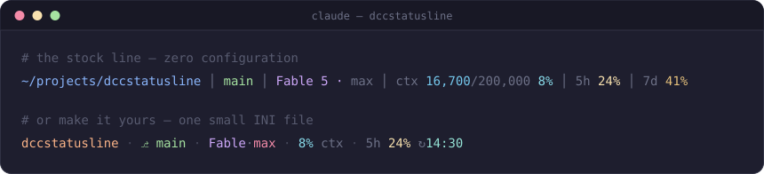
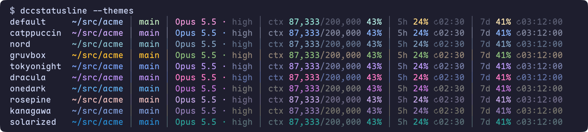
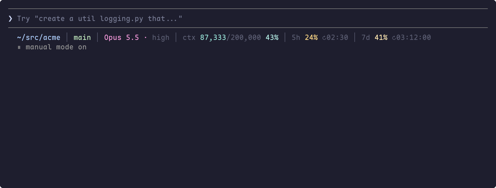

<div align="center">

# dccstatusline

**Doc's Claude Code Status Line — pure C, zero dependencies, ~250 microseconds.**

[](LICENSE)




</div>

Claude Code redraws its status line on every conversation beat — debounced to
300 ms, killing any refresh that dawdles. Most status lines answer with a shell
script that forks `jq`, forks `git`, and hopes. **dccstatusline answers with a
43 KB C binary that is done in about a quarter of a millisecond**: one read,
zero forks, zero heap allocations, one write, exit 0.

## What you get

- 🗂️ **cwd** — full, `~`-abbreviated, basename, one-letter-shrunk, or relative to the
  git repository root, and width-bounded by trailing-component depth or a hard
  character budget, so a deep work tree never eats half the line
- 🌿 **git branch** — read straight from `.git/HEAD` (worktrees and submodules
  included), never by spawning `git`; detached HEAD shows the short SHA
- 🤖 **model** — name, version derived from the model id, and effort level
  (`Fable 5 · max`)
- 🧠 **context** — tokens used, ceiling, and percentage, with digit grouping
- ⏳ **plan usage** — both rate-limit windows (5-hour and 7-day today),
  counting down to the reset (`↻04:12`) or showing its local time in 24- or
  12-hour form; the sections are window-agnostic, so if the windows ever
  change, your config doesn't
- 🎚️ **profiles** — one key decides the whole line, replacing the section
  list and every format: `profile = basic` trims it to the figures
  (`~/src/acme │ main │ Opus 5.5 · high │ ctx 43% │ 5h 24% │ 7d 41%`), and
  `detailed` adds the token counts and the reset times; `glyphs = on` adds the
  `⎇`, and under `detailed` the `↻`, and `glyphs = nerdfont` draws their Nerd
  Font equivalents and the model as a filled pill; with no profile, the
  sections and formats are your config's
- 🎨 **per-element color** — every token of every section takes its own
  foreground and background: 16 ANSI names, 256-palette numbers, or `#rrggbb`
- 🌈 **themes** — `theme = nord`, or `--theme nord` on the command line,
  restyles the whole line: catppuccin, nord, gruvbox, tokyonight, dracula,
  onedark, rosepine, kanagawa, or solarized, in one, two or three of its
  colors (`palette = duotone`); `dccstatusline --themes` prints
  them side by side, and `/dccstatusline:theme`, a Claude Code mod, picks one
  from a live preview
- 🧩 **format templates** — reorder and repunctuate each section freely;
  a token with nothing to show swallows the punctuation before it, so
  `{name} {ver} · {effort}` degrades to `Fable 5`, never to `Fable 5 ·`
- 🪶 **works with no config at all** — the defaults are the screenshot above

## Measured, not promised

| metric | value |
|---|---|
| full refresh cycle — spawn, parse, render, exit | **~250 µs** |
| syscalls per refresh | **49** |
| heap allocations | **0** |
| stripped release binary | **43 KB** |
| libFuzzer executions through the full render path, ASan+UBSan, findings | **3.3 M, zero** |

<sub>2000-run average including process spawn, release build (`-O2`, LTO),
AMD Ryzen 9 9950X, Linux. Your numbers will vary; the order of magnitude
won't.</sub>

A failed refresh can never blank your status line: on malformed, truncated, or
hostile input the binary still prints a fallback line and still exits 0 — a
guarantee enforced by construction (single exit path) and hammered by fuzzing.

## Quick start

Three routes to the same binary: a Claude Code plugin that fetches and wires
it for you, a package on Arch Linux, or by hand.

### As a Claude Code plugin

```
/plugin marketplace add gshearer/dccstatusline
/plugin install dccstatusline@dccstatusline
/dccstatusline:setup
```

A plugin cannot set `statusLine` itself. `setup` downloads the release binary
for your platform into the plugin's data directory, checks its sha256, and
points `statusLine` at it. Run it again to update. To customize, ask Claude
for a change in plain words or run `/dccstatusline:configure`: it edits the
config file described below and previews the line before writing anything.
`configure` works just as well on a binary you installed by hand.
`/dccstatusline:theme` picks a preset, its palette, a separator, a profile and glyphs from
a live preview. That picker is a Claude Code mod, a panel the plugin adds to the
harness itself, so it can show the line in color while you choose.

### Arch Linux

[`dccstatusline`](https://aur.archlinux.org/packages/dccstatusline) is in the
AUR, built from the release tarball with your distribution's own hardening
flags and kept current through your usual updates:

```sh
yay -S dccstatusline    # or any AUR helper
```

It installs `/usr/bin/dccstatusline`. Point `statusLine` at that path, as
shown at the end of the next section.

### By hand

No toolchain? Grab a static musl binary (x86_64 or aarch64, no dependencies at
all) — the `latest` URL is stable across releases:

```sh
curl -sL -o ~/.local/bin/dccstatusline \
  https://github.com/gshearer/dccstatusline/releases/latest/download/dccstatusline-$(uname -m)-linux-musl
chmod +x ~/.local/bin/dccstatusline
```

On macOS (Apple Silicon), grab the native binary — dynamically linked against
`libSystem`, since macOS has no static libc:

```sh
curl -sL -o ~/.local/bin/dccstatusline \
  https://github.com/gshearer/dccstatusline/releases/latest/download/dccstatusline-arm64-macos
chmod +x ~/.local/bin/dccstatusline
```

The binary is unsigned. `curl` does not quarantine what it downloads, so the
above just works; a *browser* download does, and Gatekeeper will then refuse to
run it until you clear the flag once:

```sh
xattr -d com.apple.quarantine ~/.local/bin/dccstatusline
```

Or build from source:

```sh
git clone https://github.com/gshearer/dccstatusline.git
cd dccstatusline
meson setup build-release -Doptimization=2 -Ddebug=false -Db_lto=true --prefix ~/.local
ninja -C build-release install
```

Then point Claude Code at it in `~/.claude/settings.json`:

```json
{
  "statusLine": {
    "type": "command",
    "command": "/home/you/.local/bin/dccstatusline",
    "padding": 0
  }
}
```

That's it — the defaults need no config file. Full build matrix (dev, ASan,
fuzzing) lives in [BUILD.md](BUILD.md).

## Configuration

One small INI file at `~/.config/dccstatusline/config` (XDG respected,
`DCCSTATUSLINE_CONFIG` overrides). Every key optional; parse errors keep that
key's default rather than breaking your line. The fully commented reference —
identical to the compiled-in defaults — is
[`examples/config`](examples/config), and every binary carries its own copy:
`dccstatusline --print-config`.

```ini
[statusline]
sections  = cwd git model context plan_short plan_long
separator = " │ "

[git]
format    = "⎇ {branch}"
branch_fg = #a6e3a1          # truecolor needs no quoting

[context]
format  = {label} {used}/{ceiling} {pct}
label   = ctx
used_fg = cyan
pct_fg  = bright_cyan

[plan_long]
format = {window} {pct} ↻{resets}
resets = clock                     # "7d 41% ↻Mon 14:30"

[cwd]
style   = repo                     # …/acme/platform/terraform/app → platform/terraform/app
max_len = 28                       # and never longer than 28 characters
```

| section | tokens |
|---|---|
| `cwd` | `{path}` — plus `style = abbrev \| full \| basename \| shrink \| repo`, `depth = N`, `max_len = N` |
| `git` | `{branch}` |
| `model` | `{name}` `{ver}` `{effort}` `{effort_plain}` `{model_tag}` `{id}` |
| `context` | `{used}` `{ceiling}` `{pct}` |
| `plan_short` / `plan_long` | `{window}` `{pct}` `{resets}` — plus `resets = countdown \| clock \| clock12` |

Every section also has `{label}`, filled from its `label =` key, and takes
`fg`/`bg` for its literal text plus `<token>_fg` / `<token>_bg` per token.

`{model_tag}` is `{name} {ver}` as one filled pill, in `model_tag_fg` on
`model_tag_bg`, or on the section's `fg` while `model_tag_bg` is unset, so
recoloring the model recolors the pill. It draws its own rounded ends, U+E0B6
and U+E0B4, in the fill's color; they need a Nerd Font. `{effort_plain}` is
`{effort}` with no color of its own, so it takes the section's `fg`.

### Themes

Nine presets ship in the binary — `catppuccin` (Mocha), `nord`, `gruvbox`
(dark), `tokyonight`, `dracula`, `onedark` (Atom One Dark), `rosepine`,
`kanagawa` (Wave), and `solarized` (dark). Each preset has its
three colors, a muted one and a background, and `[statusline] palette` decides
how many of the three the line wears:

- `tritone`, the default — the first for the directory and branch, the
  second for the model, and the third for the usage figures
- `duotone` — the same, with the usage figures in the model's color
- `monochrome` — the first for all of it

In every palette the theme's muted color paints the separator and the rest,
and the model pill under `glyphs = nerdfont` fills with the model's color and
writes on the theme's background. With no theme, the shipped default, the
line keeps its stock colors, the ones in the screenshot: each section in its
own of your terminal's 16 colors over bright black, which no palette touches.
A preset sets
colors only: each keeps the default `│` separator and glyphs, and never
changes which sections show or how the cwd is shortened. Pick one with a
single key:

```ini
[statusline]
theme = nord
palette = duotone                  # the figures in the model's blue

[cwd]
fg = red                           # keys after the theme line win over it
```

The preset applies where its line sits, so keep it first, and tweak it with
keys below. A `palette` line lays the theme again where it sits, painting over
any color key above it, so keep it right under `theme`. A config copied whole from `--print-config` restates every color
and paints over any theme, so delete the color keys you didn't change.
`dccstatusline --themes` prints every preset side by side, and
`--themes "<ini>"` lays INI keys over each preset first. It has to be the
first argument and the flags below don't reach it, so a palette, a profile or
glyphs go in the INI.



With the plugin, `/dccstatusline:theme` opens a picker. The picker is a Claude
Code mod: `plugin/hooks/register.tsx` adds it to the harness itself as a
panel, because Claude Code hides the status line while a menu is open and
prints color codes raw inside one. The panel is a preview box over a row each
for the theme, palette, separator, profile and glyphs, starting at what your
config sets. Enter moves a row to its next value and redraws the preview, and
Enter on the Apply button switches your status line to them. The palette row
picks tritone, which writes no `palette` key, duotone or monochrome. The
separator row includes a thin arrow, U+E0B1, that needs a Nerd Font. The
profile row picks basic or detailed, and starts at basic when your config has
no profile, so Apply on a preset always writes one in place of your own
`sections` and formats; to keep those, use `/dccstatusline:configure` instead.
The glyphs row is the profile's `glyphs` key, off, on or nerdfont. The theme
row starts at `no theme`, which is no theme but the way back to the stock
line; Apply writes it as no `theme` key at all. Every row
works on every preset. The options are a theme's, so on `no theme` the preview is the stock
line and every row below the theme row dims, reads `pick a theme`, and keeps
its value for when you step back to a preset. The presets use `#rrggbb` colors, so they look right only in a
truecolor terminal. Where Claude Code doesn't load the mod, or the panel can't
open, `/dccstatusline:theme` shows the `--themes` printout and asks with a menu
instead.



### Profiles and flags

A profile is a whole line decided for you. Set, it replaces `sections` and
every section's `format`, wherever those keys sit in the config, and leaves
the colors, labels, separator, digit grouping, cwd shortening and reset styles
to the config. Both draw all six sections, and neither draws a glyph until
`[statusline] glyphs = on` puts the `⎇` before the branch and the `↻` before
any reset time:

- `profile = basic` — `~/src/acme │ main │ Opus 5.5 · high │ ctx 43% │ 5h 24% │ 7d 41%`
- with `glyphs = on` — `~/src/acme │ ⎇ main │ Opus 5.5 · high │ ctx 43% │ 5h 24% │ 7d 41%`
- `profile = detailed` — `~/src/acme │ main │ Opus 5.5 · high │ ctx 87,333/200,000 43% │ 5h 24% 02:30 │ 7d 41% 03:12:00`
- with `glyphs = on` — `~/src/acme │ ⎇ main │ Opus 5.5 · high │ ctx 87,333/200,000 43% │ 5h 24% ↻02:30 │ 7d 41% ↻03:12:00`
- with `glyphs = nerdfont` — the same line, with U+E0A0 for the `⎇`, U+F021 and a space for the `↻`, the model as a filled pill with rounded ends, U+E0B6 and U+E0B4, and the effort beside it in the model's color with no `·`

`glyphs = nerdfont` needs a Nerd Font in your terminal, under either profile.
Its glyphs are private-use code points, so without one they draw as empty
boxes. The plugin's picker shows you that before anything is written, and
`--themes` does the same by hand:

```sh
dccstatusline --themes '[statusline]
profile = detailed
glyphs = nerdfont'
```

With no profile, which is the default, the line is the one in the screenshot,
or whatever your `sections` and `format` keys make of it. The `glyphs` key
does nothing there: the glyphs are the formats' own, so a Nerd Font glyph goes
in the `format` itself.

`--theme <name>`, `--palette monochrome|duotone|tritone`, `--profile <name>`
and `--glyphs on|off|nerdfont` stand in for those four keys on the command line, so a project's own settings can restyle the
line without a config of its own:

```json
"statusLine": { "type": "command", "command": "dccstatusline --theme nord --palette duotone --profile basic --glyphs on" }
```

A flag wins over its key. `--theme nord` acts as if `theme = nord` were the
config's first line: the config's own `theme` key is skipped, and its color
keys still apply on top. `--palette` lays that theme in its palette, and the
config's `palette` key is skipped. `--profile` beats `profile =`, and `--glyphs`
beats `glyphs =`. An unknown value gets one note on stderr and the config's key
stands; the line still draws.

### Keeping the cwd short

A deep monorepo path — `/mnt/volumes/source/acme/platform/terraform/projects-modular`
and its like — is wider than the rest of the line put together. The `cwd`
section shortens in three independent stages — base form, then depth, then a
hard character budget — and whatever it elides becomes a single `…`:

| config | result |
|---|---|
| *(default)* `style = abbrev` | `/mnt/volumes/source/acme/platform/terraform/projects-modular` |
| `depth = 2` | `…/terraform/projects-modular` |
| `max_len = 30` | `…/terraform/projects-modular` |
| `style = shrink` | `/m/v/s/a/p/t/projects-modular` |
| `style = shrink` + `depth = 4` | `/m/v/s/acme/platform/terraform/projects-modular` |
| `style = repo` | `platform/terraform/projects-modular` |
| `style = repo` + `max_len = 24` | `…/projects-modular` |

- **`depth = N`** keeps the last N components whole. Under `style = shrink` those
  N stay spelled out and the rest collapse to a letter each — a dot-directory
  keeps its dot, so `~/.config` reads `~/.c`, never `~/.`; under every other
  style the rest go, unless all that would go is a lone `/` or `~/`, which the
  `…/` replacing them could not make any shorter.
- **`max_len = N`** caps the path at N characters: leading components give way
  first, and only a last component that still overflows alone gets cut. It
  counts codepoints and cuts only between them, so `pröjekt` is never sliced
  mid-character — but CJK and emoji render two columns wide, so a path of them
  can run wider than N columns.
- **`style = repo`** is the one that keeps meaning per column: the path below the
  git root, the root's own directory name included, so you still see which
  project you are in. Outside a repository it falls back to `abbrev`.

## Under the hood

For the reader who enjoys knowing why it's fast:

- **No fork, ever.** The git branch comes from walking up to `.git` and
  reading `HEAD` by hand — one `open()` per directory level, worktree
  `gitdir:` files followed exactly one hop, sha256 repositories understood.
- **Zero-copy, zero-heap.** The JSON payload is parsed with a pull cursor
  over the stdin buffer; strings unescape *in place* (every rewrite shrinks,
  by proof), so rendered values are views, not copies. All buffers are fixed.
- **Hostile-input hardened.** The JSON skip path is iterative with a depth
  cap — no recursion for malicious nesting to smash — and unknown fields are
  skipped wholesale, so new Claude Code payload fields never break an old
  binary. Both external-input parsers are fuzzed through the entire render
  path under ASan/UBSan.
- **Truncation cannot tear.** The output writer saturates at capacity,
  refuses partial escape sequences, and reserves its final bytes so the
  closing SGR reset always lands — a torn line can never bleed color into
  your terminal.
- **Built strict.** `gnu23`, `-Wall -Wextra -Wpedantic -Werror`,
  `_FORTIFY_SOURCE=3`, stack protector and clash protection, LTO release,
  test suites green under AddressSanitizer and UndefinedBehaviorSanitizer.

## License

[MIT](LICENSE) © 2026 George Shearer

**Designed by** George Shearer (george at shearer dot tech) ·
**Written by** [Claude](https://claude.com/claude-code)

## Contributors

With thanks to everyone whose pull requests have been merged:

- **dk** ([@kenzik](https://github.com/kenzik)) — macOS release binary
  ([#1](https://github.com/gshearer/dccstatusline/pull/1)), cwd shortening
  ([#3](https://github.com/gshearer/dccstatusline/pull/3))
- **Michael Vendivel** ([@mven](https://github.com/mven)) — Claude Code plugin
  ([#5](https://github.com/gshearer/dccstatusline/pull/5)), spaced effort dot
  ([#6](https://github.com/gshearer/dccstatusline/pull/6)), themes, profiles,
  glyphs and the theme picker
  ([#7](https://github.com/gshearer/dccstatusline/pull/7)), theme palettes
  ([#8](https://github.com/gshearer/dccstatusline/pull/8))
